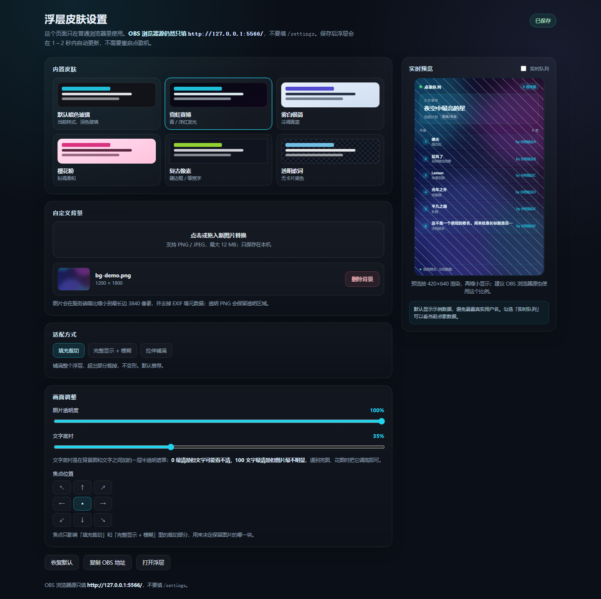

# BiliNCM Deck

BiliNCM Deck 是一个用于 B 站直播的网易云点歌工具：观众在直播间发弹幕点歌，歌曲会加入网易云音乐播放列表，当前歌曲不会被打断；同时提供 OBS 队列浮层。

`版本：v1.0.0` · `系统：Windows 10/11 x64` · `网易云音乐：2.10.13`

> 下载：[GitHub Releases](https://github.com/DDG-LAL/BiliNCM_Deck/releases/latest)

## 一、下载与部署

### 1.1 下载

到 [Releases](https://github.com/DDG-LAL/BiliNCM_Deck/releases/latest) 下载：

| 文件 | 说明 |
|---|---|
| `BiliNCM-Deck-v1.0.0-win-x64.zip` | 完整便携包，解压即用 |
| `BiliNCM-Deck-v1.0.0-win-x64.zip.sha256` | 校验文件 |

大多数用户只需要下载第一个。

可选校验：

```powershell
Get-FileHash .\BiliNCM-Deck-v1.0.0-win-x64.zip -Algorithm SHA256
```

和 `.sha256` 文件里的值对比。

### 1.2 解压与启动

1. 完整解压到硬盘，例如 `D:\BiliNCM-Deck\`
2. 不要在压缩包里直接双击运行
3. 不要放在 `C:\Program Files`（权限问题）
4. 路径里避免 `!` `&` `%` 这类符号
5. 双击 `BiliNCM-Deck.exe`，或双击 `Start-BiliNCM-Deck.cmd`

程序会常驻托盘运行。关闭浮层或设置页面不会退出程序。便携包已自包含 .NET 运行时，不需要另外安装 .NET。

### 1.3 前置条件

| 项目 | 要求 |
|---|---|
| 系统 | Windows 10/11 64 位 |
| 网易云音乐 | PC 客户端 2.10.13，已登录并保持运行 |
| B 站账号 | 能进入直播间、能开播 |
| OBS | 28 以上（只有使用浮层时需要） |
| 端口 | `5566` 未被其他程序占用；网易云调试端口 `9222` |

> 网易云音乐 3.x 已确认不兼容；其他 2.x 版本未验证，不建议使用。

### 1.4 网易云路径

如果网易云不在常见安装目录，在 `BiliNCM-Deck.exe` 同目录新建 `ncm-path.txt`，写入 `cloudmusic.exe` 的完整路径，例如：

```text
D:\CloudMusic\cloudmusic.exe
```

也可以先手动打开网易云并登录，再启动 Deck。若网易云没有开启调试端口，Deck 会尝试带 `9222` 启动它；这可能会中断当前播放，建议直播前先手动打开网易云。

### 1.5 从旧版升级

如果之前使用旧便携版：

- 把 Deck 放到旧便携版同一目录，首次启动会自动读取旧 `current\config.json`
- 放在独立目录时，可用 `BiliNCM-Deck.exe --legacy-root "旧便携版目录"` 导入配置、背景和 `ncm-path.txt`
- 旧日志和 `overlay-state.json` 不会迁移

## 二、第一次使用

### 2.1 启动程序

双击 `BiliNCM-Deck.exe` 或 `Start-BiliNCM-Deck.cmd`。如果浏览器没有自动打开，手动访问：

- OBS 浮层：<http://127.0.0.1:5566/>
- 设置页：<http://127.0.0.1:5566/settings>

### 2.2 登录 B 站并连接直播间

1. 用普通浏览器打开 <http://127.0.0.1:5566/settings>
2. 在「直播登录」区域点「扫码登录」，用手机 B 站 App 扫码
3. 填写直播间房间号，点「连接直播间」
4. 页面显示已登录、已连接即可

权限和房管标记建议在开播状态下验证；未开播或轮播时，B 站返回的身份信息可能不完整。

### 2.3 添加 OBS 浮层

1. OBS → 来源 → `+` → 浏览器
2. 名称随意，例如 `点歌队列`
3. URL 只填：`http://127.0.0.1:5566/`
4. 宽度 `420`，高度 `640`（按画面比例自行缩放）
5. 其他保持默认，不要加自定义 CSS；页面背景本来就是透明的

> 不要填 `http://127.0.0.1:5566/settings`，那是设置页，不是浮层。

### 2.4 浮层外观

在设置页可以切换内置皮肤、上传背景图、调整图片透明度、文字底衬和焦点位置。设置会自动保存，浮层在 1～2 秒内刷新。



## 三、直播时怎么用

### 3.1 普通观众

- 发 `点歌 关键词` 点歌，例如 `点歌 夜曲`
- 发 `撤回` 或 `取消` 撤回自己最近的一条待播
- 发 `撤回 关键词` 撤回自己点过的指定歌曲

普通观众不能置顶、切歌、关闭点歌、移除他人待播，也不能撤回别人点的歌。当前正在播放的歌只有主播和房管能撤回。

### 3.2 主播和房管

- `置顶 关键词`：把已有待播移动到当前歌下一首
- `置顶点歌 关键词`：新点一首，并放到当前歌下一首
- `切歌` / `跳过`：切到下一首
- `移除 关键词`：删除指定待播
- `关闭点歌` / `开启点歌`：暂停或恢复普通观众点歌

`置顶` 和 `优先` 只按歌名或点歌人昵称匹配，不匹配歌手名。例如想置顶《志铭》，用 `置顶 志铭`，不要用歌手名。

### 3.3 弹幕命令

| 指令 | 可用身份 | 作用 |
|---|---|---|
| `点歌 关键词` | 普通观众 | 加入点歌队列；不会打断当前歌 |
| `撤回` / `取消` | 点歌人本人 | 撤回自己的待播；当前歌只有主播/房管能撤回 |
| `置顶点歌 关键词` | 主播 / 房管 / SuperUser | 新请求插入当前歌下一首 |
| `置顶 关键词` / `优先 关键词` | 主播 / 房管 / SuperUser | 把指定待播移动到当前歌下一首 |
| `移除 关键词` / `移除` | 主播 / 房管 / SuperUser | 管理移除待播；不带关键词时移除自己最近一条 |
| `切歌` / `跳过` | 主播 / 房管 | 切到下一首；普通观众会被拒绝 |
| `关闭点歌` / `开启点歌` | 主播 / 房管 / SuperUser | 只影响新的普通点歌，不影响管理命令 |

> `SuperUser` 是配置文件里指定的用户；普通观众不需要关心。

### 3.4 队列规则

- 当前歌曲永远不会被打断，也不会被自动移动
- 队列以网易云播放列表为准：你在网易云里手动拖动、删除、插入的优先级最高
- 新点歌会排在最后一个待播之后；没有待播时排在当前歌之后
- 同一首歌重复点歌不会新增网易云副本；撤回只取消自己的请求，最后一条请求消失时才删除网易云副本
- `关闭点歌` 只拦截新的普通点歌；管理命令和待播撤回在暂停时仍然可用
- `置顶` / `置顶点歌` 把目标放到当前歌下一首；连续置顶时，最后一次置顶的歌排最前

## 四、托盘与退出

- 右键任务栏托盘图标：打开浮层、打开设置、打开日志目录、退出程序
- 设置页底部：退出程序
- 双击 `Stop-BiliNCM-Deck.cmd`：兜底退出

关闭浮层或设置页面不会退出程序；B 站弹幕、网易云队列和 `5566` 服务需要继续在后台运行。

## 五、运行数据与日志

配置、背景图和日志都保存在 `BiliNCM-Deck.exe` 同目录，便携包不会写入系统目录。

- `deck.log`：启动、弹幕命令、权限拒绝、队列操作、网易云连接和异常；10 MB × 3 轮转，敏感字段会自动脱敏
- `danmaku.log`：运行期间收到的全部 `DANMU_MSG`，包含本地时间、B 站时间、UID、用户名、身份和原始内容；10 MB × 3 轮转
- `crash.log`：未处理异常的崩溃栈
- `/api/logs`：最近 1000 条内存日志，便于排查问题

> `config.json` 含有 B 站登录信息，`danmaku.log` 含有观众 UID 和用户名。分享日志或配置前请先确认内容，不要直接公开。

## 六、已知限制

- 重启 Deck 会清空浮层待播列表；网易云中已存在的待播副本不会自动恢复跟踪。重启前请确认，或重新点歌。
- `置顶` / `优先` 只按歌名或点歌人昵称匹配，不匹配歌手名。
- 房管功能已实现，但建议在真实房管账号下再复核一次。
- 网易云音乐只支持 2.10.13；3.x 不兼容，其他 2.x 版本未验证。
- 不提供自动更新、强制插播或强制播放。

## 七、常见问题

**5566 页面打不开**

确认 `BiliNCM-Deck.exe` 还在运行、托盘图标还在；检查 `5566` 是否被其他程序占用，然后重启 Deck。

**网易云没有连接**

确认网易云已启动并登录，调试端口 `9222` 可用；如果网易云装在非标准路径，按 1.4 配置 `ncm-path.txt`，然后重启 Deck。

**OBS 浮层是空白**

OBS 浏览器源 URL 必须是 `http://127.0.0.1:5566/`，不要填 `/settings`。页面背景是透明的，不要额外加 CSS。

**B 站登录或房间连接失败**

在设置页重新扫码登录并确认房间号；未开播或轮播状态下，部分身份信息可能不完整。

**点歌后队列没有变化**

先看网易云右侧播放列表是否已经变化。队列以网易云为准；如果手动删除了待播，浮层会在几次轮询内跟随，不会强行加回。

## 八、许可

本项目沿用上游的 MIT 许可与版权声明，详见 `LICENSE` 和 `NOTICE`。本项目与哔哩哔哩、网易云音乐无隶属关系。

## 九、开发与记录

以下内容主要供开发和维护记录使用，普通用户不需要阅读：

- [开发与实现记录](docs/DEVELOPMENT.md)
- [目标架构](docs/ARCHITECTURE.md)
- [关键决策](docs/DECISIONS.md)
- [交接说明](docs/HANDOFF.md)
- [POC 验收](docs/POC.md)
- [队列语义移植](docs/QUEUE-PORT.md)
- [Phase 2/3 回归清单](docs/REGRESSION.md)
- [v1.0.0 发布说明](docs/RELEASE-v1.0.0.md)
